# DIYseed: metal seed backup stencil toolkit

A web tool to generate punching stencils for backing up a BIP-39 seed and passphrase on metal.

Online version at [https://diyseed.net](https://diyseed.net/).

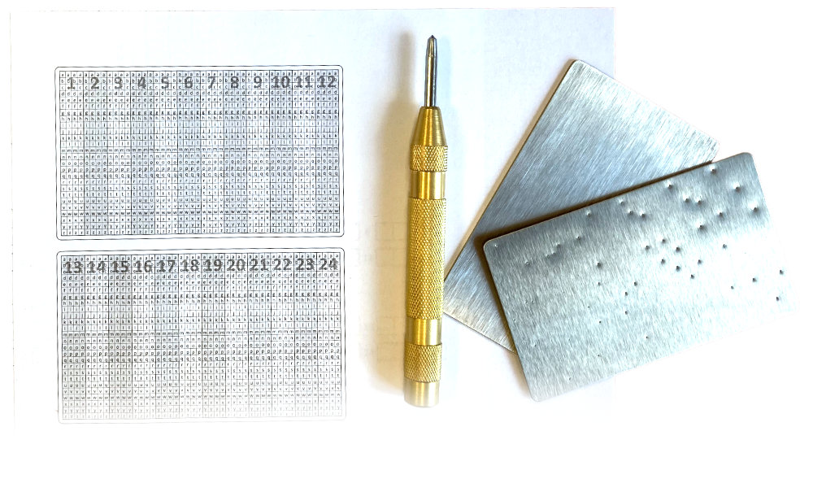

## Release notes

### v2
- Switched from a .NET console app to a JavaScript app that runs in any browser. Rendering happens entirely client-side, and each release ships as a single HTML file you can download and use offline.
- Added Number and Binary encodings alongside Alphabet. Binary fits the smallest cards.
- Added a passphrase stencil, in addition to the seed.
- Added printable reader pages for decoding a punched card without transparent foil.
- Added reference tables: the BIP-39 wordlist with indexes and bits, and an ASCII table.
- Added a [card code](#card-code) printed on every stencil page, and **Generate from card code** to regenerate the stencil and reader from it.

## Motivation

There are many commercial solutions for creating a secure backup of the seed words. But they are just overpriced pieces of metal. Especially if you are willing to create more backup tokens (for example because of Shamir backup...). I also wanted a secure way to store a passphrase, punched on its own separate piece of metal.

I wanted to create a solution for durable metal seed backup with those thoughts in mind:
- **Durability** - seed backup is as durable as commercial ones
- **It is cheap** - you do not need any special tools to create the backup
- **Variability** - it can store seeds of any length, and can be punched into pretty much anything: an old credit card, a metal sheet, even wood
- **Easy to use** - it is easy to create a backup for everyone as well as read it
- **Stealth** - commercial backup plates are branded, boxed, and obviously "crypto backup hardware." A card you punch yourself doesn't have to look like anything

Buying a commercial backup plate also means giving a company your name and shipping address, and that data doesn't always stay safe. Ledger's [2020 breach](https://www.ledger.com/addressing-the-july-2020-e-commerce-and-marketing-data-breach) exposed roughly 270,000 customers' names, addresses, and phone numbers. Trezor's [August 2026 breach](https://www.coindesk.com/tech/2026/08/13/trezor-warns-14-000-users-after-fulfilment-partner-suffers-data-breach) exposed shipping details for another ~14,000. It's not just wallet vendors either: Coinbase's [2025 insider breach](https://www.bleepingcomputer.com/news/security/coinbase-discloses-breach-faces-up-to-400-million-in-losses/) shows exchanges leak the same kind of data too, and it gets sold for targeted extortion. Do you really want the world to know you own bitcoin? Generating your own stencil in the browser means none of that data ever has to exist in the first place.

## How it works

**Writing a backup**
1. Generate a stencil PDF for your card size and seed length, and print it at 100% scale.
2. Mark each word's first 4 letters on the stencil. Other encodings store the word's index as digits or bits instead (see [Examples](#examples)).
3. Mark the corner marks too: top left, top right and bottom left.
4. Tape the stencil to the metal card and punch a dent through the paper at every mark.
5. Remove the stencil and destroy it.

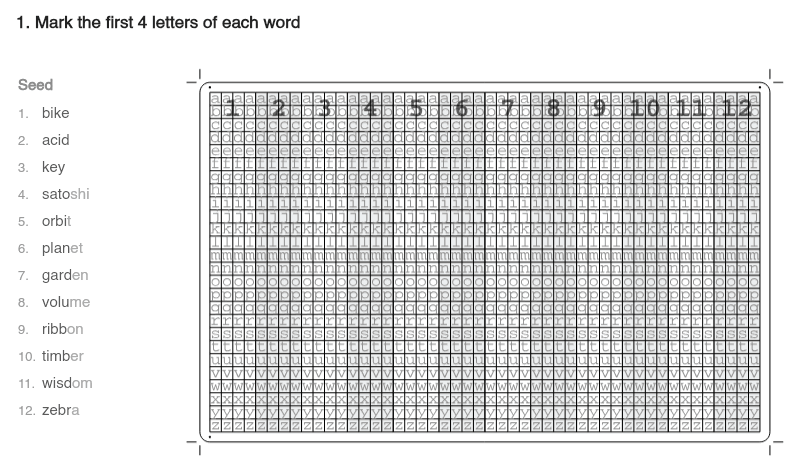

**Reading a backup**

With the printed reader page:
1. Cut along the red dashed line.
2. Slide the card in from the right, under the cut edge, until its padding is hidden.
3. Read the letter next to the cut and write it into the boxes, then slide the card one column further. The word numbers below the card show which word you are on.

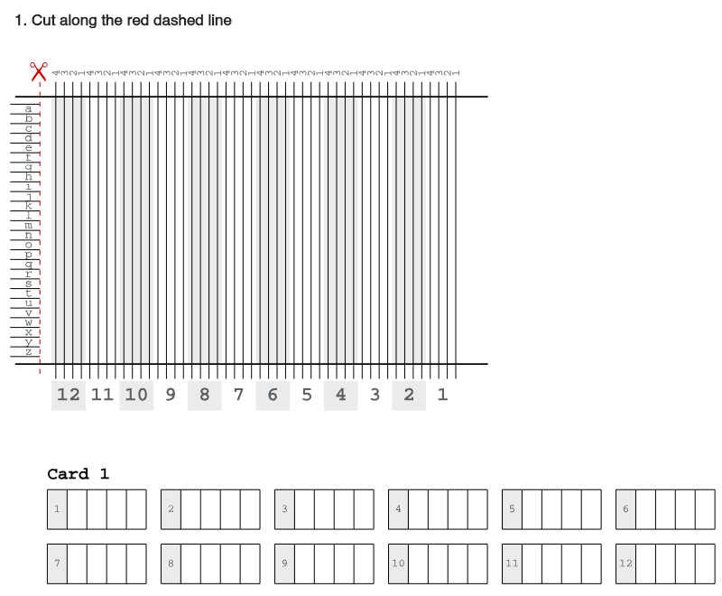

Even better: print the stencil on transparent foil or tracing paper and lay it straight over the card. You see every dent against its letter at once. Align it to the top-left corner: the only corner with a row of dots, one dot per row number.

Either way, a wallet completes each word from its first 4 letters.

**Corner marks**

Besides the data, every stencil has a few dots outside the mesh. Punch them like any other mark. They tell you which way up the card is, and which card and row you are holding, so a set can be put back in order even when the cards get mixed up.

1. **Row number**: dots above each row's top-left corner. The first dot sits directly above the mesh's left edge, in the middle of the padding above the row. The next ones follow to the right, one cell width apart (closer only if they would not fit the row). Row 1 gets one dot, row 2 two dots, and so on. The dots count rows in reading order, across all cards of a set: each card side is at least one row, and Card split adds more. Example: 24 words split over both sides of a credit card (12 + 12) is side A = row 1 (one dot), side B = row 2 (two dots).
2. **Row end**: one dot directly above the mesh's right edge, in the middle of the same padding.
3. **Card end**: one dot directly below the mesh's left edge, half the padding below the card's last row.

Each dot sits centred in the padding: above the first row, in the padding-wide gap between rows, and below the last row. Seed and passphrase cards use the same marks. Only the top-left corner has a row of dots, so align the reader there.

#### Seed, card split = 2

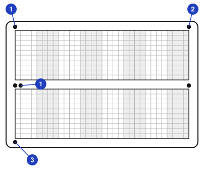

One card side, two rows. The next card side continues the count: 3, 4 dots.

#### Passphrase

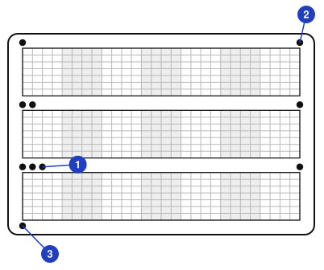

Three rows, each a separate passphrase. The next card continues the count: 4, 5, 6 dots.

#### Detail

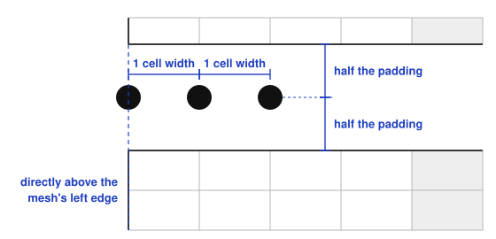

Row 3, top-left corner, to scale (3 mm padding, 2 mm cells).

## Running locally

```
npm install
npm run dev            # Vite dev server, http://localhost:5173
npm test               # Vitest
npm run build          # single self-contained file -> build/index.html
```

The app builds to one HTML file with all scripts and styles inlined. Open it straight from disk, offline, or host it anywhere static. Every version tag (`v2.0.1`) publishes it to [GitHub Releases](https://github.com/diyseed/diyseed.core/releases) as `diyseed-<version>.html`. The tag is the version. `package.json` only carries the major version, bumped by hand; a tag with a different major version fails the release.

The sample images and animations in `docs/images` are generated from the real generator by the scripts in [`docs/media`](docs/media/README.md).

The generator is also an npm library (`@diyseed/generator`), installed from Git:

```
npm install git+https://github.com/diyseed/diyseed.core.git
```

```ts
import { GeneratorParameters, generateWriterPdf, mm } from '@diyseed/generator';

const pdf: Uint8Array = await generateWriterPdf(
  new GeneratorParameters({ cardSize: { width: mm(85.6), height: mm(54) }, cardCount: 1, seedLength: 12 }),
);
```

The library has no UI and no DOM dependency. Export groups:

- **Generation:** `generateStencilPdf`, `generateWriterPdf`, `generatePassphrasePdf`, `GeneratorParameters`, `PassphraseParameters`, `encodeSeedConfigCode`, `encodePassphraseConfigCode`, `decodeConfigCode`.
- **Form validation:** `validate`, `toGeneratorParameters`, `toPassphraseParameters`, `DEFAULT_FORM_VALUES`, `pdfFilename`, `codeFromSearch`, `seedCellWarnings`, `passphraseWarnings`.
- **Layout:** `layoutSeedCard`, `layoutPassphraseCard`, the stencil-card model shared by the PDF writer and the SVG output.
- **SVG:** `cardSvg`, `cardSizeSvg`. Output carries class names only (`ds-*`, `card-diagram__*`), consumers supply styling.

## Generator options

A client-side TypeScript web app. No install, no server, no account. Fill in your card and seed parameters, and it generates the stencil PDF entirely in your browser.

### Parameters

The form validates every value against the ranges below before it generates anything. The generator classes (`GeneratorParameters`, `PassphraseParameters`) throw a `RangeError` for the same ranges, with one exception: passphrase cell size, where they only reject values of 0 or less. The ranges live in `src/generator/config.ts` (`*_RANGE` / `*_DEFAULT` constants).

#### Card (shared by seed and passphrase)

| Form field | Range | Default | Notes |
|---|---|---|---|
| Card size (mm) | 20 – 180 mm per side | 85.6 × 54 mm | Default is a credit card (ISO/IEC 7810 ID-1). |
| Card padding (mm) | 1 – 5 mm | 1.5 mm | Blank border inside the card, around the punch mesh. |
| Card corner radius | 0 – 5 mm | 1.5 mm | Not in the form, always the default. |

- **Card size:** the 20 mm floor is arbitrary (smaller cards can't fit a usable mesh). The 180 mm ceiling is what fits on an A4 page inside the margins.
- **Padding and corner radius** are cosmetic. Pick them to match your card.

#### Seed stencil

| Form field | Range | Default | Notes |
|---|---|---|---|
| Seed length (words) | 10 – 39 | 12 | |
| Split over (card sides) | 1 – 13 | 1 | How many card sides the words are spread across. |
| Stencil sets | 1 – 10 | 1 | Identical stencil sets in one PDF. |
| Card split (rows per card) | 1 – 5 | 1 | Word rows per card, for taller cards. Ignored for Binary. |
| Encoding | Alphabet / Number / Binary | Alphabet | Each word as its 4-letter prefix, its BIP-39 index (0–2047) as 4 digits, or that index as 11 bits. |

- **Seed length:** a real BIP-39 seed is 12, 15, 18, 21 or 24 words. Other lengths exist for non-standard backups (partial backups, SLIP-39 shares).
- **Split over:** each card is one side of a physical card (1/2 are sides A/B of the first card, 3/4 the next one). Past ~6 sides, punching and reassembling in order gets unwieldy.
- **Cell size:** derived from card size, padding, word count and encoding. Under 1.5 mm (`MIN_CELL_SIZE_MM`) is too small for a center punch on metal, and more elongated than 2:1 (`MAX_CELL_ASPECT_RATIO`) makes dents ambiguous to read. The app doesn't show warnings; consumers get the same checks from `seedCellWarnings(params)` and `passphraseWarnings(params)`.

#### Passphrase stencil

| Form field | Range | Default | Notes |
|---|---|---|---|
| Passphrase | on / off | on | At least one of Seed or Passphrase must be on. |
| Stencil sets | 1 – 10 | 1 | Identical stencil sets in one PDF. |
| Passphrase cell size (mm) | 1 – 10 mm | 2 mm | Range checked by the form only. 1 – 1.5 mm generates, but is probably not punchable. |
| Card count | 1 | 1 | Not in the form. The library accepts 1 – 13. |

Each passphrase character is punched as 7-bit ASCII. The card holds as many passphrase rows as fit its height.

#### Output pages

Each section has its own checkboxes for what goes into the PDF:

| Section | Pages |
|---|---|
| Seed | Stencil, Seed reader, Seed wordlist (BIP-39 word → index → bits) |
| Passphrase | Stencil, Passphrase reader, Passphrase ASCII (character → code → bits) |

The PDF is named after the card codes it contains: `diyseed_seed<seed code>_pass<passphrase code>.pdf`, or just the part that is generated, e.g. `diyseed_seed1-0856-0540-15-12-01-1-1.pdf`. A PDF with only reference tables is `diyseed.pdf`.

#### Previews

The app is a plain form without previews. Consumers that want them (the diyseed website does) draw them from the library:

- `cardSvg(layout, options?)` takes a `SeedCardLayout` from `layoutSeedCard(card, encoding)` or a `PassphraseCardLayout` from `layoutPassphraseCard(params, cardNumber, startRowNumber)`, plus optional `CardSvgOptions` (`wordNumbers`, `headers`, `cellLabels`). It returns `{ markup, viewBox, card }` in mm. The cell size comes from the parameters (`GeneratorParameters.cellSize`, `PassphraseParameters.cellSize`) and the card code from `encodeSeedConfigCode` / `encodePassphraseConfigCode`.
- `cardSizeSvg(widthMm, heightMm, paddingMm)` returns `{ viewBox, label, markup }`: the card outline with its width and height in mm and the padding as a dashed line.

The SVG carries class names only (`ds-*` for cards, `card-diagram__*` for the card-size drawing), no colours, so the consumer supplies the styling. The PDF writer uses the same layout, so previews match the printed stencil.

### Card code

Reading a card back needs a stencil generated with the same settings it was punched from (card size, padding, seed length, card count, rows, encoding). So every stencil page prints a short **card code** in large type below the cards, e.g. `1-0856-0540-15-12-01-1-1`. Copying it onto the card (scratch it, stamp it, or write it on the card's sleeve) is optional, just a convenience: without it you can still measure the card and try settings until the stencil lines up.

To use it, click **Generate from card code** on the generator page and type the code in. You get the full recovery kit for that card's whole set: the stencil, the reader, the BIP-39 wordlist and the ASCII table, built straight from the code and independent of the rest of the form.

A code can also be shared as a link: opening the generator with `?code=<card code>` (e.g. `https://diyseed.net/generator/?code=1-0856-0540-15-12-01-1-1`) opens the **Generate from card code** dialog with the code filled in. Generating still takes a click.

Every card of a set carries the same code (the corner marks already tell the cards apart). Every field is plain digits, so the code can be read by a person without the app:

| Stencil | Format | Example |
|---|---|---|
| Seed | `F-WWWW-HHHH-PP-LL-SS-R-E` | `1-0856-0540-15-12-01-1-1` |
| Passphrase | `F-WWWW-HHHH-PP-CCC` | `2-0856-0540-15-020` |

| Field | Meaning |
|---|---|
| `F` | Code type and layout: `1` seed, `2` passphrase |
| `WWWW` / `HHHH` | Card width / height in tenths of a millimeter (`0856` = 85.6 mm) |
| `PP` | Card padding in tenths of a millimeter (`15` = 1.5 mm) |
| `LL` | Seed length in words |
| `SS` | Card count (sides the seed is split over) |
| `R` | Rows per card (card split) |
| `E` | Encoding: `1` Alphabet, `2` Number, `3` Binary |
| `CCC` | Passphrase cell size in tenths of a millimeter (`020` = 2 mm) |

The first digit alone decides how the rest of the code is read. If the layout ever needs to change, it gets a new first digit instead of changing an existing one, so a card punched today will regenerate the same stencil even after the generator changes.

## Examples

Sample stencils generated by the tool, cropped to the card. All seed samples are punched with the same example seed, so the encodings compare directly:

`bike acid key satoshi orbit planet garden volume ribbon timber wisdom zebra`

**Alphabet, single line.** 12 words on a credit card (85.6 × 54 mm). Each cell holds a letter; the four cells under each word number mark that word's 4-letter prefix.

Punched (bold part): **bike** **acid** **key** **sato**shi **orbi**t **plan**et **gard**en **volu**me **ribb**on **timb**er **wisd**om **zebr**a

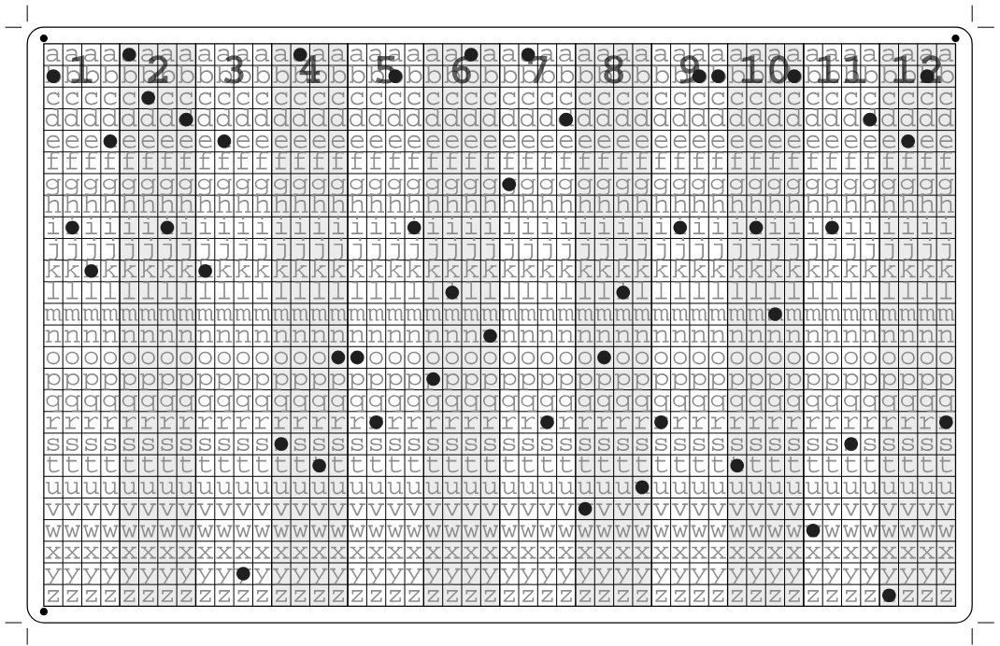

**Alphabet, two rows (Card split = 2).** The same seed extended to 24 words, on an 85.6 × 100 mm card. Splitting into rows keeps the cells close to square. Rows are separated by a padding-sized gap and each gets its own corner marks.

Punched (bold part): **bike** **acid** **key** **sato**shi **orbi**t **plan**et **gard**en **volu**me **ribb**on **timb**er **wisd**om **zebr**a / **anch**or **cany**on **dolp**hin **elbo**w **foss**il **glim**pse **harb**or **isla**nd **jung**le **lemo**n **magn**et **nobl**e

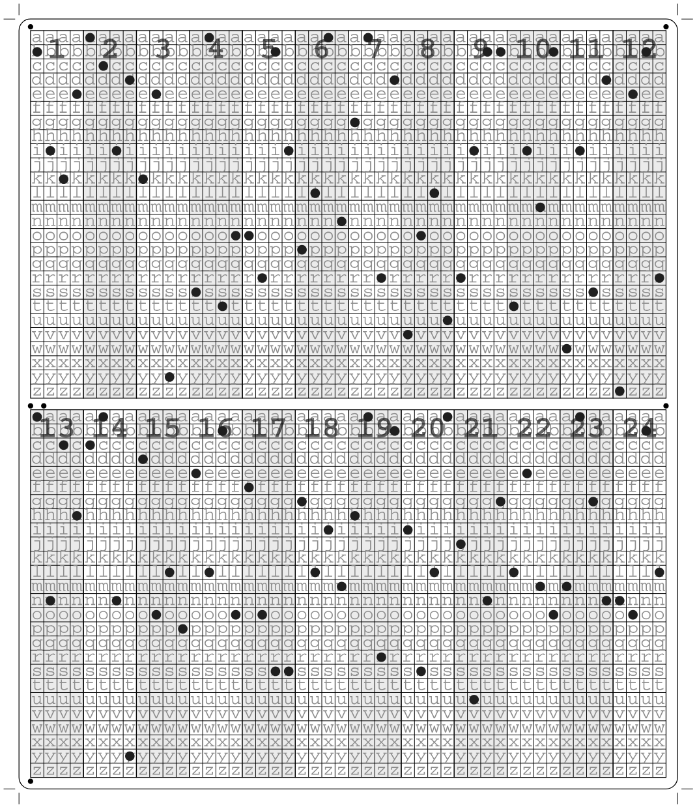

**Number.** The 12-word seed on an 85.6 × 21 mm card. Same layout as Alphabet, with digit rows (0–9). Each word is punched as its BIP-39 index.

Punched (word → index): bike `0177` · acid `0015` · key `0976` · satoshi `1531` · orbit `1247` · planet `1327` · garden `0765` · volume `1966` · ribbon `1480` · timber `1809` · wisdom `2018` · zebra `2044`

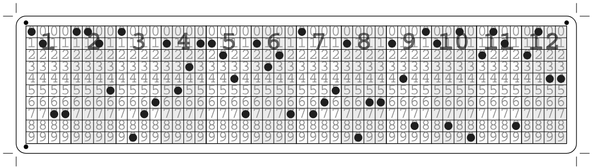

**Binary.** The 12-word seed on a 40 × 35 mm plate. Each word is a column of 11 bits (place values 1024–1, shown at left) encoding its BIP-39 index.

Punched as bits (word → index): bike `177` · acid `15` · key `976` · satoshi `1531` · orbit `1247` · planet `1327` · garden `765` · volume `1966` · ribbon `1480` · timber `1809` · wisdom `2018` · zebra `2044`

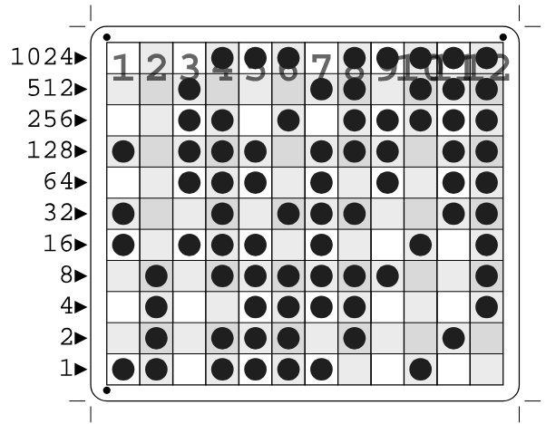

**Passphrase.** A credit card with 2 mm cells and three passphrase rows. Each column is a character position, each row a bit place value of its ASCII code.

Punched: row 1 `Satoshi2026!`, row 2 `my second phrase`, row 3 empty

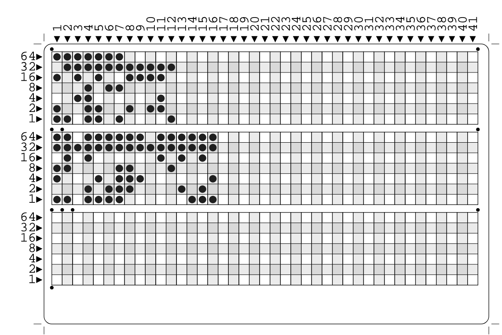
